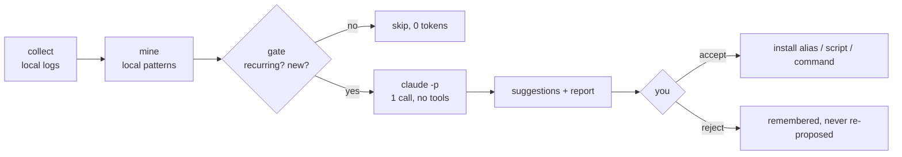

# habit-scout

[](https://github.com/athulmurali/habit-scout/actions/workflows/test.yml)


[](LICENSE)

**A frugal, once-a-day agent that notices what you keep doing by hand and proposes small
automations for it.**

habit-scout reads your local developer activity (zsh history, VS Code, Claude Code sessions),
mines it for repeated work on your machine, and only when it finds something new and recurring
asks Claude for a suggestion. You get a short list of aliases, scripts and slash commands to
accept or reject. Nothing is installed until you say yes, and whatever you reject is never
suggested again.

```text
$ scout list
#12  [proposed] newbranch: branch off a release tag in one step  (script, ~6 min/wk)

$ scout accept 12
installed ~/.local/bin/newbranch.sh
```

## Why

Most "AI productivity" tools watch you all the time and call a model on every keystroke.
habit-scout works the other way around:

- **Local first.** Collecting and pattern mining is plain Python on your machine and costs zero tokens.
- **Silent by default.** The model is called only when a pattern recurs across several days and
  hasn't been seen before. On most days it doesn't run at all.
- **Learns your taste.** Accept and reject decisions, and the reasons you give, go into the next
  prompt, so it gets pickier about the kinds of things you turn down.
- **Cheap.** In real use: 26 daily runs, 7 LLM calls, **$0.13 total**.

## How it works



1. **Collect.** Incremental readers for `~/.zsh_history`, a small zsh hook (`cwd`, exit code,
   whether you were in the VS Code terminal), VS Code's local file History and workspaces, and
   `~/.claude/projects` session logs (your prompts, plus the shell commands Claude ran for you).
   Everything is stored in `~/.habit-scout/scout.db`.

2. **Mine** (zero tokens). Normalizes commands (`git commit -m <str>`, `cd <path>`), then finds:
   - repeated commands
   - 2–4 step command chains within a work session
   - near-duplicate prompts you keep giving Claude
   - files of the same shape you keep creating (template candidates)
   - **command templates**: the same action typed with different arguments each time. Aliases are
     expanded, equivalent commands are unified (`git switch -c` → `git checkout -b`), and the
     parts that change become slots:

     ```text
     git checkout -q -b feature-login-form refs/tags/v1.4.0
     git checkout -b fix-cache-timeout refs/tags/v1.5.2        ─►  git checkout -b <*> <*>
     git switch -c chore-bump-deps refs/tags/v1.6.0                (seen 20x over 5 days)
     ```

     Flags must match exactly, so different operations are never merged.

3. **Gate.** This step decides whether the model gets called at all:
   - a pattern must recur on ≥3 distinct days, ≥4 times, and cost ≥2 minutes over 14 days
   - patterns already covered by one of your aliases are skipped
   - rejected items are never re-proposed (fuzzy-matched for prompts and sequences)
   - unanswered suggestions expire to *ignored* and stay quiet for 45 days
   - patterns the model declined aren't re-sent for 21 days
   - no call at all when nothing is new, or when ≥5 suggestions are still waiting for a decision

4. **Advise.** One `claude -p` call with **no tools, no MCP, no session persistence** and
   JSON-schema output. The prompt tells the model that "nothing" is a valid answer. Suggestions
   below 0.6 confidence are dropped, and at most 3 are kept per day. A typical call uses 3–5k
   tokens and costs $0.02–0.04.

## Privacy

- Everything is read and stored locally in `~/.habit-scout/` (mode `700`).
- Only a **redacted summary of patterns** is sent to Claude. Tokens, API keys, URL credentials,
  JWTs, emails and long opaque strings are scrubbed first ([`scout/redact.py`](scout/redact.py)).
- `scout run --dry-run` prints the exact payload that would be sent without calling anything.
- Each raw model reply is saved under `~/.habit-scout/logs/` so you can audit it.
- Raw events are deleted after 60 days (`retention_days`).

## Requirements

- macOS (uses launchd and `osascript` notifications)
- zsh
- `python3` 3.9+ (the system one is fine, standard library only, nothing to `pip install`)
- [Claude Code](https://claude.com/claude-code) CLI, logged in. LLM calls are billed to that account.
- VS Code is optional. Without it, set `"sources": {"vscode_user": null}`.

## Install

```sh
git clone https://github.com/athulmurali/habit-scout.git
cd habit-scout
./install.sh
```

`install.sh`:
- symlinks `scout` into `~/.local/bin`
- adds one `source …/habit-scout.zsh  # habit-scout` line to `~/.zshrc`
- loads a LaunchAgent (`com.habit-scout.daily`)

Open a new terminal, then:

```sh
scout candidates        # see what it has found so far (free)
```

It needs a few days of history before patterns cross the threshold. Your existing
`~/.zsh_history` and Claude Code logs are read on the first run, so you may see candidates
right away.

**Scheduling.** The LaunchAgent wakes up every hour. `scout run --scheduled` exits immediately
unless it's past `run_after_hour` (18:00 by default) and today's run hasn't happened yet, so if
your laptop was asleep in the evening, the run happens the next time it wakes.

> Using nvm or another Node version manager? Re-run `./install.sh` after switching versions so
> the agent can still find `claude`, or set `CLAUDE_BIN=/path/to/claude ./install.sh`.

### Uninstall

```sh
./uninstall.sh           # removes LaunchAgent, zshrc line, CLI symlink
./uninstall.sh --purge   # ...and deletes ~/.habit-scout
```

Scripts and slash commands you accepted are left in place.

## Usage

| Command | What it does |
|---|---|
| `scout candidates` | Patterns that passed the gate and would be sent (free, no LLM) |
| `scout run --dry-run` | Print the exact LLM payload. Calls nothing, saves nothing |
| `scout run` | Run now (doesn't use up the scheduled evening run) |
| `scout list [--all]` | Suggestions waiting for a decision |
| `scout show ID` | A suggestion's reasoning and file contents |
| `scout accept ID [-y]` | Install it (see below) |
| `scout reject ID -r "why"` | Never suggest it again. The reason is used in future prompts |
| `scout status` | Recent runs, token spend, and whether accepted automations reduced the habit |
| `scout config` | Print the effective configuration |

Where `scout accept` puts things:

| kind | destination |
|---|---|
| `alias`, `function` | appended to `~/.habit-scout/aliases.zsh` (sourced by the zsh hook) |
| `script` | `~/.local/bin/` (never overwrites an existing file) |
| `claude_command` | `~/.claude/commands/` → available as `/name` in Claude Code |
| `vscode_task`, `vscode_snippet`, `git_alias`, `other` | prints manual install steps |

Daily reports are written to `~/.habit-scout/reports/YYYY-MM-DD.md`, and logs to
`~/.habit-scout/logs/scout.log`.

## Configuration

Every setting is declared, with a comment, in `DEFAULTS` in [`scout/config.py`](scout/config.py).
To change one, put just that key in `~/.habit-scout/config.json`. Nested groups are merged key
by key, unknown keys are reported, and `scout config` prints the result.

```json
{
  "model": "haiku",
  "run_after_hour": 20,
  "min_days": 4,
  "sources": { "vscode_user": null },
  "install": { "scripts_dir": "~/bin" }
}
```

| Group | Keys | Controls |
|---|---|---|
| schedule | `run_after_hour`, `notify` | when the daily run happens; macOS notification |
| thresholds | `window_days`, `min_days`, `min_count`, `min_minutes`, `recent_days`, `session_gap_min`, `template_similarity`, `max_candidates`, `max_pending` | what counts as a habit worth automating |
| memory | `ignore_after_days`, `ignored_cooldown_days`, `passed_cooldown_days`, `retention_days` | how long decisions and raw events are remembered |
| LLM | `claude_bin`, `model`, `max_suggestions`, `min_confidence`, `digest_char_budget`, `llm_timeout_sec`, `environment` | the single `claude -p` call |
| `sources` | `zsh_history`, `shell_log`, `vscode_user`, `claude_projects` | where events are read from; `null` disables one |
| `install` | `scripts_dir`, `claude_commands_dir` | where `scout accept` puts scripts and slash commands |
| filters | `alias_files`, `trivial_commands`, `ignore_path_parts` | what is never suggested |
| matching | `command_synonyms`, `noise_flags` | which commands count as the same action |

Two settings are environment variables because they're needed before the config is read:
`HABIT_SCOUT_HOME` (data directory, default `~/.habit-scout`) and `CLAUDE_BIN` (used by `install.sh`).

## Troubleshooting

| Symptom | Fix |
|---|---|
| `scout: command not found` | Open a new terminal; the hook adds `~/.local/bin` to `PATH` |
| `claude CLI not found` during install | `CLAUDE_BIN=$(which claude) ./install.sh` |
| `llm error: claude exited 1` in the log | Run `claude` once interactively to make sure you're logged in |
| Never any candidates | Normal for the first few days. Check `scout candidates`; the `filtered:` counts show why patterns were dropped. Lower `min_days` / `min_count` to experiment |
| Did the scheduled run happen? | `launchctl print gui/$(id -u)/com.habit-scout.daily` and `tail ~/.habit-scout/logs/scout.log` |

## Project layout

```text
scout/
  collect.py   incremental readers for each local source
  mine.py      pattern mining: commands, chains, templates, prompts, new files
  advise.py    gate, digest, the single claude -p call, saving suggestions
  redact.py    secret scrubbing
  store.py     SQLite schema
  config.py    every tunable, with defaults
shell/         zsh hook
launchd/       LaunchAgent template
tests/
```

## Development

```sh
python3 -m unittest discover -s tests
PYTHONPATH=. python3 -m scout candidates       # run from the checkout
HABIT_SCOUT_HOME=/tmp/hs PYTHONPATH=. python3 -m scout run --dry-run   # isolated data dir
```

Contributions are welcome. See [CONTRIBUTING.md](CONTRIBUTING.md).

## Roadmap ideas

- Linux support (systemd timer and bash hook in place of launchd and zsh)
- Other model backends behind the same single-call interface
- Better adoption tracking for accepted automations

## License

MIT. See [LICENSE](LICENSE).
