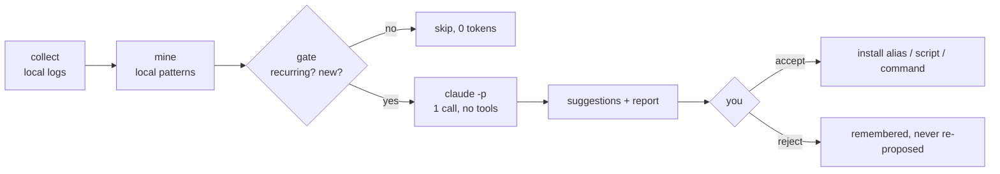

# habit-scout

A once-a-day background agent that watches how you work in VS Code (editor, integrated
terminal, Claude Code sessions), finds the things you keep doing by hand, and proposes small
automations: aliases, scripts, VS Code tasks/snippets, Claude slash commands. Nothing is
installed until you say so.

## How it stays cheap



- **collect**: incremental readers for `~/.zsh_history`, the zsh hook log (`cwd`, exit code,
  `TERM_PROGRAM=vscode`), VS Code's local file History + workspaces, and `~/.claude/projects`
  session logs (your prompts, and shell commands Claude ran). Stored in `~/.habit-scout/scout.db`.
- **mine**: normalizes commands (`git commit -m <str>`, `cd <path>`), counts repeated commands,
  2–4 step command chains per session, clusters near-duplicate prompts, and spots repeatedly
  created files of the same shape (template candidates). Zero tokens.
  It also finds **command templates**: the same action written differently each time. Chains are
  split into steps, your aliases are expanded, equivalent commands are unified (`git switch -c` →
  `git checkout -b`), and steps that share a shape are aligned so the varying parts become slots:

  ```
  git checkout -q -b feature-login-form refs/tags/v1.4.0
  git checkout -b fix-cache-timeout refs/tags/v1.5.2        ─►  git checkout -b <*> <*>
  git switch -c chore-bump-deps refs/tags/v1.6.0                (seen 20x over 5 days)
  ```

  Flags must match exactly, so different operations are never merged. The LLM sees sample slot
  values and the steps that usually run alongside, so it can propose one parameterized script for
  the whole workflow.
- **gate** (the "wisdom" part):
  - must recur on ≥3 distinct days, ≥4 times, and cost ≥2 minutes in the 14-day window
  - skipped if one of your existing aliases already covers it
  - never re-proposes rejected items (fuzzy-matched for prompts/sequences)
  - unanswered suggestions expire to *ignored* and stay quiet for 45 days
  - patterns the LLM declined are not re-sent for 21 days
  - no LLM call at all when nothing is new, or when ≥5 suggestions await your decision
- **LLM**: `claude -p` with a short custom system prompt, **no tools**, no MCP, no session
  persistence, JSON-schema output. It is told silence is a valid answer and sees your past
  accept/reject decisions (with reasons) so its bar adapts. Results under 0.6 confidence are
  dropped; at most 3 per day. Typical run: ~2k tokens, ~$0.01.

Secrets (tokens, keys, URL creds, emails, long blobs) are redacted before anything is sent.

## Requirements

macOS (launchd, notifications), zsh, the system `python3` (standard library only), and the
[Claude Code](https://claude.com/claude-code) CLI logged in; each LLM call bills that account.
VS Code is optional: without it, disable `sources.vscode_user`.

Privacy: it reads your shell history and Claude Code session logs locally; only redacted pattern
summaries go to Claude. Use `scout run --dry-run` to see exactly what would be sent.

## Install

```sh
./install.sh        # symlinks `scout` into ~/.local/bin, adds a hook line to ~/.zshrc, loads LaunchAgent
./uninstall.sh      # reverse it (add --purge to delete ~/.habit-scout)
```

The LaunchAgent wakes hourly; `scout run --scheduled` exits instantly unless it is past
`run_after_hour` (18:00) and today's run hasn't happened, so a missed evening (laptop asleep)
is caught on the next wake. If you switch Node versions with nvm, re-run `./install.sh` so the
agent can find `claude`.

## Use

```sh
scout candidates            # what the miner found & what would be sent (free)
scout run --dry-run         # print the exact LLM payload, call nothing
scout run                   # run now (the evening scheduled run still happens)
scout list                  # pending suggestions
scout show 3
scout accept 3              # alias/function → ~/.habit-scout/aliases.zsh, script → ~/.local/bin,
                            # claude_command → ~/.claude/commands; others print manual steps
scout reject 3 -r "I already use ctrl-r for this"
scout status                # runs, token spend, and whether accepted automations reduced the habit
```

Daily reports: `~/.habit-scout/reports/YYYY-MM-DD.md`. Logs: `~/.habit-scout/logs/scout.log`.

## Config

Every setting is declared, with a comment, in `DEFAULTS` in [`scout/config.py`](scout/config.py).
To change one, put just that key in `~/.habit-scout/config.json`. Nested groups merge key by key,
unknown keys are reported, and `scout config` prints the effective result.

```json
{
  "model": "haiku",
  "run_after_hour": 20,
  "min_days": 4,
  "sources": { "vscode_user": null },
  "install": { "scripts_dir": "~/bin" }
}
```

| Group | Keys | Controls |
|---|---|---|
| schedule | `run_after_hour`, `notify` | when the daily run happens; macOS notification |
| thresholds | `window_days`, `min_days`, `min_count`, `min_minutes`, `recent_days`, `session_gap_min`, `template_similarity`, `max_candidates`, `max_pending` | what counts as a habit worth automating |
| memory | `ignore_after_days`, `ignored_cooldown_days`, `passed_cooldown_days`, `retention_days` | how long decisions and raw events are remembered |
| LLM | `claude_bin`, `model`, `max_suggestions`, `min_confidence`, `digest_char_budget`, `llm_timeout_sec`, `environment` | the single `claude -p` call |
| `sources` | `zsh_history`, `shell_log`, `vscode_user`, `claude_projects` | where events are read from; `null` disables one |
| `install` | `scripts_dir`, `claude_commands_dir` | where `scout accept` puts scripts and slash commands |
| filters | `alias_files`, `trivial_commands`, `ignore_path_parts` | what is never suggested |
| matching | `command_synonyms`, `noise_flags` | which commands count as the same action |

Two settings are environment variables because they are needed before the config is read:
`HABIT_SCOUT_HOME` (data directory, default `~/.habit-scout`) and `CLAUDE_BIN` (used by `install.sh`).

## Tests

```sh
python3 -m unittest discover -s tests
```

## License

MIT — see [LICENSE](LICENSE).
